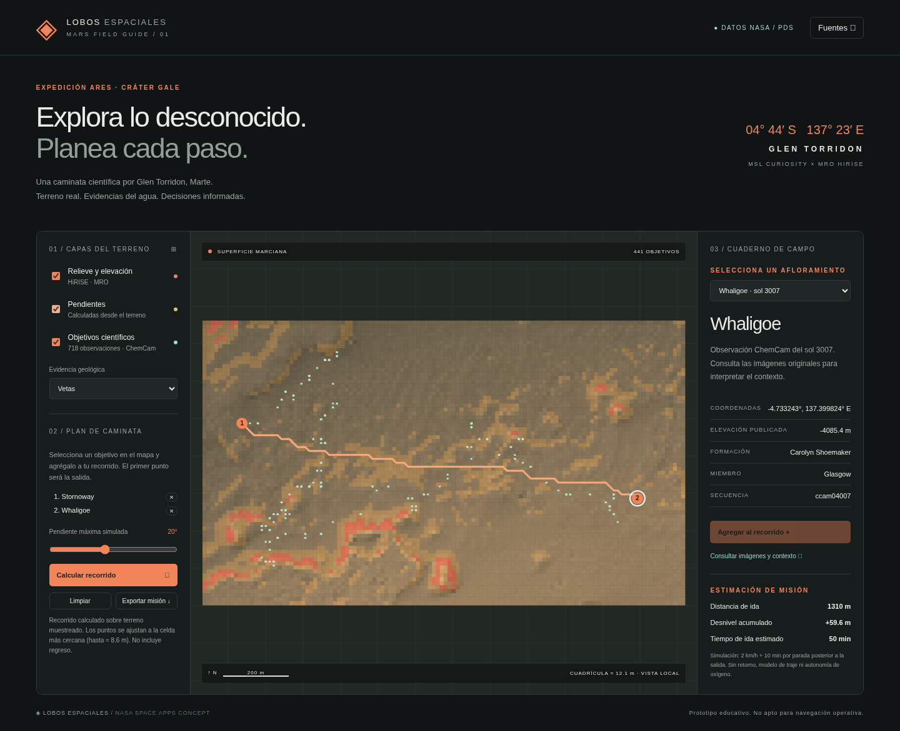

# Lobos Espaciales · Ojo de Marte

**Versión actual: v1.3.1 «Bitácora KSP» · 2 de noviembre de 2026.** [Historial completo de actualizaciones](docs/HISTORIAL.md).

**Explorador educativo de Marte con fotografía orbital real, terreno 3D y planificación de caminatas científicas.** Reúne datos de MRO/HiRISE y Curiosity/ChemCam para explorar **Glen Torridon, en el cráter Gale**, estudiar evidencias de agua antigua y planear recorridos sobre un modelo de elevación.

**[Abrir el proyecto](https://lobos-espaciales-python.onrender.com/)** · **[Guía de uso](docs/USO.md)** · **[Instalar en tu PC](docs/INSTALACION_LOCAL.md)** · **[Mapa KSP](docs/KSP_MAPA.md)** · **[Mapas descargables / SCANsat](docs/KSP_MAPAS_DATOS.md)** · **[Bitácora de pruebas KSP](docs/KSP_COLABORADORES.md)** · **[HUD / futuro casco](docs/AR_KSP.md)** · **[Fuentes y créditos](docs/REFERENCIAS.md)**



## De qué trata

El proyecto plantea cómo un astronauta podría elegir puntos de interés y preparar una caminata científica. Permite consultar **718 objetivos ChemCam**, identificar vetas y nódulos, agregar puntos propios y calcular una ruta que considere pendientes y celdas sin datos.

Además del explorador, incluye un **laboratorio de navegación para KSP 1**, usado como ventana auxiliar junto al juego. El objetivo posterior es adaptar una interfaz de pocas distracciones a un casco de astronauta con funciones similares a un visor tipo Quest. El hardware y su integración física todavía no están definidos ni validados.

Es un prototipo independiente inspirado en NASA Space Apps. No implica afiliación ni aprobación de NASA y no es una herramienta certificada para operaciones espaciales.

## Qué puedes hacer

| Función | Comportamiento actual |
| --- | --- |
| Mapa 2D y terreno 3D | Fotografía orbital HiRISE real en blanco y negro sobre elevaciones; zoom, giro, inclinación y desplazamiento. |
| Globo de Marte | Contexto global con acceso al recorte de Glen Torridon; la alta resolución está limitada a esa zona. |
| Objetivos científicos | 718 registros con coordenadas, sol, formación y clasificación de vetas/nódulos. |
| Puntos personalizados | Crear por clic o coordenadas, nombrar, eliminar y mezclar con objetivos científicos. Se guardan en tu navegador. |
| Planificación Python | Rutas de 2–20 paradas, límite de pendiente de 5°–40°, distancia, ascenso y tiempo educativo. |
| Astronautas | Dos personajes recorren la ruta; pausa, avance manual y cámara de seguimiento. |
| Vista de superficie | Reconstrucción 3D a nivel del terreno. No son panoramas fotográficos Street View. |
| Indicaciones y voz | Giros, distancias, paradas y llegada; voces españolas del dispositivo, ritmo y volumen. |
| Mapa nativo KSP | Malla de alturas del cuerpo activo leída de kRPC, vehículo, destinos por cuerpo, rutas y recálculo; demo sintética para probar sin juego. |
| HUD de entrenamiento | Ventana auxiliar sin cámara ni solicitudes WebXR; demostración del HUD o telemetría local de KSP 1. |
| AR experimental | Cámara HUD y maqueta WebXR sobre superficies en dispositivos compatibles. |
| Recálculo y polvo | Replanificación desde la posición actual por desvío o cambio de escenario; zonas de tormenta hipotéticas y pausa si no hay paso. |
| Exportación | JSON con paradas, ruta, métricas, supuestos y fuentes. |

## Mapas de KSP descargables

La versión v1.2.0 «Atlas KSP» permite guardar regiones de kRPC e importar alturas de SCANsat. Prepara rutas sin el juego o conecta una región guardada al vehículo del mismo cuerpo. Consulta [fuentes, exportación y conversión de CSV](docs/KSP_MAPAS_DATOS.md). Los mapas orbitales gruesos no sustituyen el muestreo local para conducir un rover.

## Colaborar probando KSP

En el documento [Bitácora de pruebas KSP](docs/KSP_COLABORADORES.md), los colaboradores pueden registrar sus experiencias con la integración real, enlazar logs y evidencias, describir errores y proponer mejoras. Incluye una plantilla para añadir cada sesión al mismo documento mediante un commit o pull request.

## Primera prueba en cinco pasos

1. Abre la [aplicación pública](https://lobos-espaciales-python.onrender.com/).
2. Pulsa **Objetivos**, selecciona **Stornoway** y **Agregar al recorrido**.
3. Selecciona **Whaligoe** y agrégalo también.
4. Deja la pendiente en **20°** y pulsa **Calcular recorrido**. El ejemplo produce unos **1.31 km**, **+59.6 m** de ascenso y **50 minutos** simulados, sin regreso.
5. Pulsa **Seguir astronauta** e **Iniciar / pausar recorrido**. En **Navegación paso a paso**, activa o prueba la voz. Usa **1× o 5×** para oír los avisos con calma.

El panel de control está a la izquierda y se adapta al espacio disponible. Consulta la [guía completa](docs/USO.md) para crear objetivos, usar las cámaras, exportar y abrir los menús KSP/AR.

## Ejecutar en tu computadora

El mapa y la API solo necesitan **Python 3.10 o posterior** y un navegador moderno. No requieren Node.js, pip, cuentas NASA ni claves de API. Los datos y Three.js están incluidos. El conector opcional de KSP sí tiene dependencias propias.

```bash
git clone https://github.com/FULLY4425/Lobos-espaciales-beta-nasa.git
cd Lobos-espaciales-beta-nasa
python3 server.py
```

En Windows, usa `py -3 server.py`. Abre **http://localhost:5173/** y mantén la terminal abierta. No abras `index.html` directamente ni uses un servidor exclusivamente estático: las rutas y exportaciones necesitan la API Python.

- [Instalación y solución de problemas en Windows, macOS y Linux](docs/INSTALACION_LOCAL.md)
- [Alojamiento y despliegue en Render](docs/DESPLIEGUE.md)


## Mapa y guía para Kerbal Space Program

**Mapa KSP** abre un espacio nativo en `/ksp-map.html`: usa el radio, las coordenadas y las alturas del cuerpo activo de KSP 1. Permite muestrear una región, marcar destinos, planificar con pendientes/agua, seguir el vehículo, escuchar indicaciones y recalcular desde su posición. No necesita calibrar el cuerpo del juego como si fuera Marte.

[Guía del mapa nativo KSP](docs/KSP_MAPA.md). En Render puedes probar la demo sintética; para datos de una partida usa `http://localhost:7173/ksp-map.html` con el conector actualizado.

## HUD de entrenamiento y futuro casco

El modo de entrenamiento anterior utiliza **KSP 1 + kRPC**, con un conector Python en el PC del juego. **HUD KSP** se abre como ventana auxiliar del navegador; no es un menú nativo añadido dentro de KSP.

El conector lee posición, rumbo y velocidad. Una calibración asocia la posición inicial del vehículo con la salida de la ruta; no controla el vehículo ni convierte Duna en Marte. El sitio en Render no puede acceder por sí solo a tu partida local.

**[Instalación paso a paso de kRPC, comandos y calibración](docs/AR_KSP.md)**.

El modo **AR** es un prototipo separado: la cámara HUD superpone indicaciones sin seguimiento espacial, y WebXR permite colocar una maqueta del terreno cuando el dispositivo admite `immersive-ar` y `hit-test`. No representa caminar físicamente sobre una ruta marciana. La adaptación a un casco real sigue pendiente.

## Desvíos y cambios del entorno

La guía recalcula al detectar un desvío de más de 30 m, conservando las paradas pendientes. Puedes probarlo con **Probar desvío del astronauta** o usando el movimiento libre de la vista de superficie. La telemetría calibrada de KSP también activa el recálculo.

En **Entorno · simulación** elige despejado, polvo atmosférico o tormenta local. El servidor evita las zonas restringidas del escenario y actualiza el tiempo con velocidades educativas. Si no existe una ruta válida, se pausa la guía. **Los escenarios no son clima actual ni predicciones de NASA.**

[Modelo, parámetros, limitaciones y demostración](docs/CLIMA_RECALCULO.md).

## Qué datos son reales y qué se simula

| Elemento | Procedencia / alcance |
| --- | --- |
| Elevación | DTM MRO/HiRISE `DTEEC_009149_1750_009294_1750_U01`; cuadrícula incluida de 122 × 72 celdas, aproximadamente 12.14 m por celda. |
| Fotografía local | Ortofotografía `PSP_009149_1750_RED_C_01_ORTHO`, banda RED en escala de grises; aproximadamente 1.012 m/píxel. |
| Objetivos | Conjunto de Gasda et al. en NASA/PDS: 718 objetivos ChemCam, soles 2300–3007. |
| Textura del globo | Solar System Scope, CC BY 4.0; contexto visual global, separado de los datos locales. |
| Recorridos y tiempos | Cálculos educativos del proyecto, no recorridos humanos observados. |
| Astronautas, cielo y vista de superficie | Representación visual y animación sobre el modelo; no imágenes de astronautas en Marte ni fotografías desde el suelo. |
| HUD KSP / AR | Simulación o correspondencia local calibrada; no GPS ni navegación operativa de un traje. |

[Referencias completas y licencias](docs/REFERENCIAS.md) · [Investigación](docs/INVESTIGACION.md) · [Cobertura y coordenadas](docs/COBERTURA.md) · [Hashes de los datos](public/data/provenance.json) · [Metadatos de la ortofoto](public/imagery/metadata.json).

## Supuestos y límites

- El cálculo evita celdas ausentes, pendientes que superen el límite y diagonales por esquinas bloqueadas. A* penaliza desniveles; no demuestra transitabilidad humana.
- Los puntos se ajustan a la cuadrícula, con un desplazamiento de hasta aproximadamente **8.6 m**. Obstáculos menores que la resolución no están representados.
- En el escenario despejado, el tiempo usa **2 km/h + 10 minutos por parada posterior a la salida**; los escenarios de polvo cambian la velocidad educativa. No incluye regreso, oxígeno, traje ni evacuación. La animación acelerada no cambia esas métricas.
- Las alturas del modelo no se exageran en 3D. La precisión horizontal absoluta y la alineación vertical con las alturas científicas no están verificadas independientemente.
- No hay clima actual, radiación local, capa CRISM integrada ni autonomía de trajes. Los datos de NASA Science mostrados son contexto planetario general.
- Los puntos propios se guardan localmente, hasta 50; no se sincronizan entre compañeros. Las misiones exportadas incluyen los puntos utilizados.
- Las voces dependen del navegador y dispositivo. Calcular y exportar requiere el servidor Python; la aplicación necesita acceso al servidor.

## Documentación y desarrollo

| Documento | Contenido |
| --- | --- |
| [Guía de uso](docs/USO.md) | Mapa, cámaras, objetivos, rutas, astronautas, voz y ejemplos. |
| [Instalación local](docs/INSTALACION_LOCAL.md) | Descarga, Python y problemas frecuentes. |
| [AR y KSP](docs/AR_KSP.md) | Menú de prueba, instalación del mod, conector, calibración y futuro casco. |
| [Referencias](docs/REFERENCIAS.md) | Fuentes científicas, imágenes, dependencias y créditos. |
| [Arquitectura y API](docs/DESARROLLO.md) | Estructura, contratos, pruebas, distribución y contribuciones. |
| [Validación](docs/VALIDACION.md) | Evidencia disponible y pruebas pendientes con hardware real. |

Pruebas de Python:

```bash
python3 -m unittest discover -s test -v
```

Pruebas JavaScript opcionales para desarrollo, con Node.js moderno:

```bash
node test/directions.test.js
node test/ar-tracking.test.js
node test/replanning.test.js
node test/ksp-geo.test.js
```

**Estado de validación:** 31 pruebas Python y 18 JavaScript aprobadas; también se realizaron pruebas de navegador con cámara/telemetría simuladas. El HUD anterior tiene una prueba parcial en KSP 1.12.5; faltan la validación real del mapa nativo, la importación de una exportación de SCANsat y las pruebas en un visor o casco físico. Los detalles están en [VALIDACION.md](docs/VALIDACION.md).

Conservar los créditos de NASA/JPL/University of Arizona, Gasda et al. y Solar System Scope al reutilizar sus recursos. Cada fuente conserva sus condiciones; no se atribuye una licencia única a los datos de terceros.
