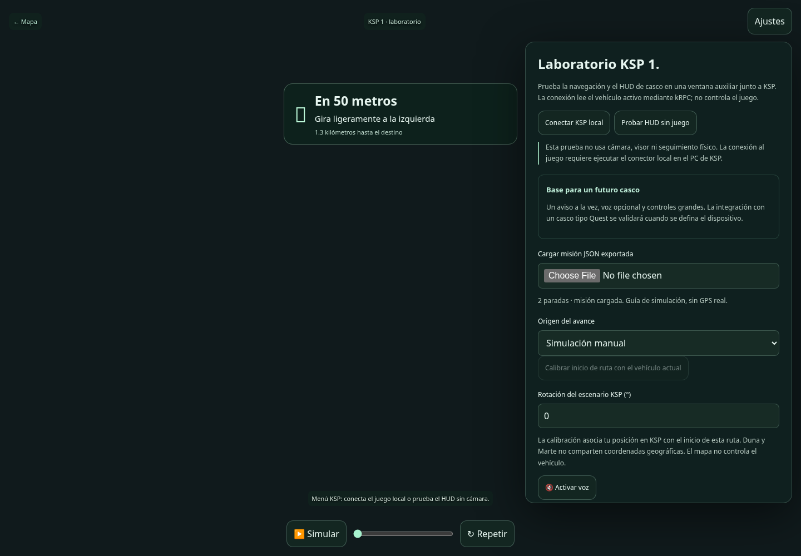

# Ojo de Marte: HUD de entrenamiento, AR y KSP 1

Para usar **el cuerpo y terreno propios del juego**, entra en [Mapa KSP](KSP_MAPA.md). Esta guía describe el HUD de entrenamiento que conserva una ruta marciana y la pantalla AR; ambas funciones permanecen disponibles.

## Fase actual: laboratorio KSP y futuro casco

La prueba actual se realiza en **Prueba KSP**, un menú independiente en
`/ksp.html` que se abre como ventana auxiliar junto al juego. No inserta una
ventana nativa dentro de KSP. No solicita cámara ni consulta WebXR. Puedes
conectar el juego local o probar el HUD con una misión simulada.

El casco de astronauta con características similares a Quest es el objetivo
posterior: se conserva el HUD compacto y la voz como base de interfaz. El modo
AR experimental permanece separado en `/ar.html`. No se presupone que el
futuro casco utilice el mismo SDK, óptica, seguimiento o sistema de entrada de
Quest; eso se determinará al definir el hardware.

## Qué está implementado

- **Cámara HUD:** un aviso de navegación sobre la cámara, sin seguimiento espacial.
- **AR espacial WebXR:** coloca una maqueta del terreno HiRISE y la ruta en una
  superficie detectada. Un punto muestra el avance simulado o recibido de KSP.
- **Vista previa:** la misma interfaz mínima sin pedir acceso a la cámara.
- **KSP 1 / kRPC:** conector local de solo lectura de posición, rumbo, velocidad,
  cuerpo celeste y altitud del vehículo activo. No toca mandos ni piloto automático.

No equivale a caminar físicamente por Marte ni a proyectar una ruta marciana a
escala real sobre la calle. El HUD no usa GPS. El seguimiento espacial de WebXR
coloca una maqueta; la posición en la misión viene del simulador o del control
manual. El juego no recibe órdenes del navegador.

## Abrir una misión en AR

1. Calcula una ruta en el mapa y pulsa **Modo AR**.
2. Elige **Iniciar AR espacial**, **Abrir cámara HUD** o **Vista previa**.
3. Oculta **Ajustes** para dejar solo el siguiente aviso. Puedes variar su opacidad.
4. Activa la voz si la necesitas. No se reproduce automáticamente.
5. Usa **Simular** para una reproducción de dos minutos o mueve el control de avance.

También puedes importar el JSON generado por **Exportar misión**. El archivo
se valida contra la cuadrícula local, tiene un máximo de 2 MB y no se sube al
servidor. La página AR no carga el globo ni la lista completa de objetivos.

En AR espacial, busca una superficie y toca el círculo para colocar la maqueta.
El tamaño inicial es de 0.5 m de ancho y puede ajustarse entre 0.2 y 1 m. Usa
**Recolocar maqueta** para buscar otra superficie. El mapa y las distancias de
la misión no cambian cuando redimensionas la maqueta.

## Compatibilidad de dispositivos

La cámara necesita HTTPS o `localhost`, permisos y un navegador compatible con
`getUserMedia`. WebXR requiere `immersive-ar` y detección de superficies
(`hit-test`). Se comprueba la capacidad en el navegador y el inicio puede ser
rechazado si faltan permisos o funciones del visor.

Utiliza un dispositivo cuyo navegador y sistema admitan las funciones WebXR requeridas. La disponibilidad de passthrough/AR en Quest u otras gafas
depende de su navegador, sistema y soporte WebXR; no se garantiza por marca.
Si no hay WebXR se ofrecen cámara HUD y vista previa. No se instala un SDK
nativo de visor ni se usa una captura de cámara sin autorización.

## Por qué KSP 1

Se ha elegido KSP 1 por su integración mediante mods y kRPC. Este conector
**no es para KSP 2**. Las propiedades usadas se comprobaron en el cliente
Python kRPC 0.7.0. Instala una versión del mod de servidor kRPC compatible con
ese cliente y con tu instalación de KSP 1.

- Mod y versiones: https://github.com/krpc/krpc/releases
- Cliente Python: https://pypi.org/project/krpc/0.7.0/

## Ejecutar el conector en el PC del juego

Primero instala el mod del servidor kRPC desde sus [releases oficiales](https://github.com/krpc/krpc/releases), siguiendo las instrucciones de la versión compatible con tu KSP 1. Los archivos del mod van en la carpeta `GameData` del juego; reinicia KSP después de instalarlos. Usa un servidor compatible con el cliente Python 0.7.0 fijado en este repositorio.

Descarga el [repositorio](https://github.com/FULLY4425/Lobos-espaciales-beta-nasa), extrae el ZIP si procede y abre una terminal en la carpeta que contiene `server.py`. Necesitas Python 3.10 o posterior en el **mismo PC del juego**.

**Windows (PowerShell):**

```powershell
py -3 -m venv .venv
.venv\Scripts\python.exe -m pip install -r integrations/requirements-ksp.txt
.venv\Scripts\python.exe integrations/ksp_server.py
```

Si `py` no está disponible, usa `python` para crear el entorno. Estos comandos usan directamente su ejecutable y no requieren cambiar la política de ejecución de PowerShell.

**macOS / Linux:**

```bash
python3 -m venv .venv
.venv/bin/python -m pip install -r integrations/requirements-ksp.txt
.venv/bin/python integrations/ksp_server.py
```

Mantén esa terminal abierta. No hace falta iniciar también `server.py`: el conector ya sirve la aplicación en el puerto 7173.

1. Abre KSP 1, selecciona un vehículo/rover y activa el servidor del mod kRPC.
2. Mantén kRPC en `127.0.0.1`, RPC 50000 y stream 50001; inicia su servidor y acepta la solicitud del cliente si el mod la muestra.
3. Abre `http://localhost:7173/`, calcula una ruta y entra en **Prueba KSP**.
4. En el menú de pruebas pulsa **Conectar KSP local**.
5. Para la primera prueba usa un rover sobre terreno relativamente llano. Con el vehículo en el lugar que quieras usar como salida, pulsa **Calibrar
   inicio de ruta**. A partir de ahí, desplázalo usando los controles del juego.

Puedes cambiar los puertos del cliente local:

```sh
.venv/bin/python integrations/ksp_server.py --port 7173 --rpc-port 50000 --stream-port 50001
```

En Windows usa `.venv\Scripts\python.exe` en lugar de `.venv/bin/python`.

La conexión HTTP y la RPC se limitan al equipo local de forma predeterminada.
El conector ofrece la misma aplicación y `/api/ksp`, evitando conexiones del
navegador desde Render al puerto local del juego. El servicio público en Render
no puede acceder a tu KSP: muestra un mensaje para iniciar el conector local.

Para usar un visor conectado al PC hace falta servir esta misma
aplicación/conector mediante HTTPS de confianza accesible en tu red privada,
por ejemplo con un proxy inverso hacia `127.0.0.1:7173`. Los dispositivos deben
confiar en su certificado y poder alcanzar el PC. Eso requiere configuración
adicional de la red/visor; no se habilita automáticamente ni se evita TLS.
No publiques el servidor kRPC en Internet.

## Calibración y límites del seguimiento

Duna, Kerbin y Marte no comparten mapa ni dimensiones. Se usa el radio real
que devuelve KSP para convertir el cambio local de latitud/longitud en metros,
y se asocia la posición inicial del vehículo con el primer punto de la misión.
**Rotación del escenario KSP** permite ajustar la orientación de esa asociación.
Esto es una correspondencia local calibrada, no una conversión científica de
Duna a Marte ni una comprobación de obstáculos del juego.

El conector consulta como máximo unas cinco muestras por segundo; el HUD pide
una actualización cada 500 ms sin solapar solicitudes. Si cambia el vehículo,
el cuerpo celeste o la conexión, hay que recalibrar. Datos de más de tres
segundos dejan de considerarse conectados en el servidor. Si el desvío respecto
a la ruta supera 30 m, se pausa la voz y se recalcula desde la posición proyectada
en el terreno marciano, conservando la calibración inicial. No se calcula sobre
el terreno real de KSP. Si no existe un paso o la posición está fuera del mapa,
se suspende la guía y se requiere reintentar.

## Menos consumo y menos elementos en pantalla

- Pantalla AR independiente, sin globo, paneles laterales ni astronautas complejos.
- Voz opcional, un aviso compacto, opacidad ajustable y controles de al menos 44 px.
- El modo cámara HUD no usa WebGL ni un bucle de dibujo de vídeo en JavaScript.
- WebXR carga Three.js solo cuando está disponible y usa una malla de terreno
  pequeña, sin sombras ni efectos de posprocesado. Renderiza al ritmo del visor.
- La cámara, la reproducción y las consultas se detienen al salir; al ocultar
  la página se detiene la cámara HUD y el sondeo de KSP.

## Validación realizada y pendiente

Pruebas automatizadas de rutas, coordenadas relativas, cambio de vehículo,
datos obsoletos y lecturas del adaptador con un cliente simulado. Pruebas de
navegador de HUD, permisos/cierre de cámara con dispositivo de cámara simulado,
importación de misión, telemetría simulada y rechazo de sesión WebXR.

**Pendiente:** prueba de aceptación en un visor AR real y en una partida
real de KSP 1 con el mod kRPC. Este entorno no dispone de esos dispositivos ni
del juego; no se afirma validación física ni rendimiento medido en visor.

## Problemas frecuentes en la prueba KSP

| Situación | Comprobación |
| --- | --- |
| `No module named krpc` | Instala `integrations/requirements-ksp.txt` con el mismo Python que inicia el conector. |
| No hay telemetría | Selecciona un vehículo en una partida, activa el servidor kRPC y revisa dirección y puertos. |
| Render no conecta con el juego | Abre la aplicación del conector en `http://localhost:7173/` dentro del PC del juego. |
| No aparece la misión en el menú | Calcula la ruta y entra desde **Prueba KSP**, o importa un JSON exportado de esta versión. |
| Cambié de nave, cuerpo o conexión | Vuelve al lugar de salida elegido y recalibra. |
| La guía se pausa por desvío | El recálculo no encontró un paso o la posición quedó fuera del mapa. La guía no conoce los obstáculos reales de KSP. |
| Puerto 7173 ocupado | Inicia el conector con `--port 7174` y abre esa nueva dirección. |



Los escenarios de polvo del HUD son hipotéticos. Consulta [CLIMA_RECALCULO.md](CLIMA_RECALCULO.md) para el comportamiento del recálculo y sus límites.
